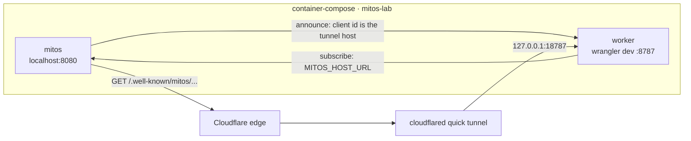

# mitos-lab — a local delivery stack

A two-service [`container-compose`](../../../container-compose) stack that runs
the **preprod mitos host** and **minting-engine** locally, so the
announce → fetch → verify → move path can be iterated without deploying either
side.



The tunnel is not optional. The host's artifact fetch is **HTTPS-only by
design** (mitos D8), and the URL is derived from the client id the worker
announces. A quick tunnel gives the worker a real hostname with a valid
certificate, which is both.

## Where this sits

This is the first version of the local stack named in
[`docs/design/PLANE_LANDING.md`](../../docs/design/PLANE_LANDING.md) §8, and the
`mitos/deploy/local/` fixture named by container-compose's roadmap. It already
closes the loop that hurts most: the host runs as it does in a deployment, and
the companion runs in workerd with local DO and D1 state.

The plane work is additive, not a second stack: `MITOS_DATA_PLANE=book` selects a
published live book for every host query, and `up.sh --plane book` mounts one. A shadow
diff adds a second host service over the same inputs. Nothing here should fork into a
parallel compose file.

## Prerequisites

- macOS with Apple's `container` 1.6+ running (`container ls` succeeds; `container
  system status` answers `unregistered` from a shell other than the one that started the
  runtime, so it is not a liveness probe).
- The container DNS domain registered once per machine:
  ```toml
  # ~/.config/container/config.toml
  [dns]
  domain = "test"
  ```
  ```sh
  container system stop && container system start
  sudo container system dns create test
  ```
- `cloudflared`, `container-compose`, `cargo-zigbuild` and `wrangler` on `PATH` —
  the mitos devshell has all four. Run the script through `direnv exec .` from
  the repo root.
- A sibling `cnft.dev-workers` checkout at `../cnft.dev-workers`, or
  `WORKER_SRC=/path/to/cnft.dev-workers`. The worker cannot live in this repo:
  it belongs to the consumer.
- Built community-module artifacts under
  `community-modules/<name>/target/mitos/` (`mitos-build --module
  community-modules/<name>/<name>.rs`). `up.sh` refuses to start without them
  rather than staging an empty directory.

## Run

```sh
direnv exec . deploy/local/up.sh
```

The script:

1. builds `minting-engine` (and refreshes its own `cip-25-mint` module artifact
   if its source is newer), passing this checkout as `MITOS_SRC`;
2. cross-builds `mitos` for `aarch64-unknown-linux-musl` and copies it into
   `mitos-image/`;
3. starts a Cloudflare quick tunnel to `127.0.0.1:18787` (the worker's published
   port);
4. stages `cip-25-mint`, `cip-68-mint` and `credit-address` from
   `community-modules/` into `generated/community-modules/` — the host refuses a
   subscribe for a module it has no artifact for, and the in-tree `cip-25-mint`
   is the parent instance the announced build moves away from. `--fold` adds
   `holders-from-fold` to that set;
5. renders `generated/mitos.toml`, `generated/namespaces.toml` and the worker's
   `.dev.vars` from that tunnel hostname;
6. runs `container-compose up` in the foreground.

The first run is slow: the musl cross-build compiles the whole mitos workspace,
and Dolos starts syncing preprod from genesis. **The move does not need chain
tip** — both instances start at origin, so catch-up completes immediately.

### Point it at a policy that has mints

The default policy is the `cip-25-mint` golden fixture's. That fixture is a
**mainnet** block, so on a preprod follower its interest matches nothing and the
host never dials the companion. To watch delivery rather than only the move,
name a preprod collection that has mints — and give the same value to
`onboard.sh`:

```sh
POLICY=<preprod-policy-hex> direnv exec . deploy/local/up.sh
./deploy/local/onboard.sh <preprod-policy-hex>
```

The policy must be supplied on both sides: see “the dial-back pins one policy”
under Known gaps. A policy with no `collections` row onboards with just the
policy interest; the credit-address watch is skipped.

### Run it book-backed

The host can answer from a published live book instead of Dolos's stores. The artifact is
mmapped read-only from the repository's scratch directory, so it has to live there:

```sh
# build a window if there isn't one (chunks 1848–1851 is 92,165 rows at slot 40,003,168)
direnv exec . cargo run -q -p fold-probe -- fold \
    --immutable ~/data/mithril/immutable --start 1848 --chunks 4 --primitives \
    --book .tmp/book-window-1848

# 220 refs for 0a85dd15…, 0 for the default cip-25-mint fixture policy
POLICY=0a85dd1543465407852c90e66c074a3b52ea2d7c77a2346ddc20550a \
    direnv exec . deploy/local/up.sh --plane book --book .tmp/book-window-1848
./deploy/local/onboard.sh 0a85dd1543465407852c90e66c074a3b52ea2d7c77a2346ddc20550a
```

`--datum <dir>` adds a `datum.tbl` capture beside the book (`MITOS_DATUM_DIR`). Both flags
name host paths under `.tmp/`; the stack mounts that directory at `/books` and refuses a
path outside it rather than creating a bind the host never reads.

### Run it serving a fold artifact

A fold artifact is a directory `fold-probe pilot` writes: a manifest (`artifact.meta`) and
the files it names. `--fold` mounts it, points the host at it (`MITOS_FOLD_ARTIFACT`) and
stages the `holders-from-fold` module, which reads the artifact through the `fold-data`
interface and emits the holder snapshot — no chain, no policy scan, no Dolos.

```sh
# the pilot: chunks 0..=1999 of the mainnet store → 294 holders / 68,994,134 units
direnv exec . cargo run -q --release -p fold-probe -- pilot \
    --immutable ~/data/mithril/immutable --start 0 --chunks 2000 \
    --policy 407ca40d92693cb737f1cfedb98023ae753038d8c6ca9e02483d79c6 \
    --book .tmp/pilot/book-2000 --out .tmp/pilot/full

direnv exec . deploy/local/up.sh --fold .tmp/pilot/full
```

The host logs `fold artifact served` on the first `fold-data` call and the module logs
`serving holder-table/v1 · policy … · base slot …`. What this does **not** wire is a
subscriber: `holders-from-fold` starts when a companion names it, exactly like every other
module, so minting-engine (which subscribes to `cip-25-mint`) leaves it activated and idle.
The read-and-emit path is exercised end to end by the platform acceptance test, which
needs no stack at all:

```sh
direnv exec . cargo test -p mitos-platform --test holders_from_fold -- --nocapture
```

That test boots the real host, activates the real built module, drives `rebootstrap`,
and compares the emission against `holders.tsv` parsed independently in the test.

**One wasm, several policies.** `--fold` also accepts a directory of artifacts named by
module id: `<dir>/<module-id>/artifact.meta`. Each module then serves its own table, and
because the wasm is content-addressed the host holds one copy of the bytes no matter how
many variants name it. `fold-probe pilot --out .tmp/fold/holders-a` per policy, then
`--fold .tmp/fold`. The acceptance test covers both shapes — a variant with an artifact
emits, a variant without one stays silent.

**Network mismatch is the point, not a bug.** The chunk store on this workstation is
mainnet and the stack follows preprod, so a fold artifact served here is a mainnet table
on a preprod host. The module reports the artifact's base slot in `SnapshotBegin` and does
not compare it with the followed chain — a reader that cares pairs the two.

What to read back: `up.sh` prints `data plane: book`, the host logs
`data plane selected plane="book"`, and `/_admin/status` reports the book's `base_slot`
as the tip (`40003168` for the window above) with `archive_horizon_slot: null`. Dolos is
still running as the tail, so its own tip is not what that field shows — that is the
point of routing the admin routes through the selected plane.

A windowed book is a snapshot: it holds the UTxOs created inside its window, not the whole
live set. A policy whose outputs predate the window returns nothing, which looks like a
broken plane and is not. Use a whole-store book when the module needs the full live set.

**Match the network.** The chunk store on this workstation (`~/data/mithril`) is **mainnet**,
so every book folded from it is a mainnet artifact. The stack itself follows **preprod**. A
mainnet book on this host exercises the read path — it is what the native and container
smokes did — but the rows and the followed chain are different networks, so no policy will
line up. A coherent book-backed acceptance needs a preprod chunk store (or a mainnet host).

## Watch the move

`up.sh` prints the tunnel hostname. The token is in `.env`:

```sh
set -a; . deploy/local/.env; set +a

curl -s -H "Authorization: Bearer $MITOS_AUTH_TOKEN" \
  http://127.0.0.1:8080/_admin/status

curl -s -H "Authorization: Bearer $MITOS_AUTH_TOKEN" \
  http://127.0.0.1:8080/_admin/modules/cip-25-mint/rows

curl -s -H "Authorization: Bearer $MITOS_AUTH_TOKEN" \
  http://127.0.0.1:8080/_admin/modules/cip-25-mint/instances
```

`./deploy/local/admin.sh <path>` does the same without putting the token on the
command line.

The row should go `fetching` → `planned` → catch-up → switch, pointing at an
instance keyed by the wasm sha the worker announced. The worker's own log is the
other half:

```sh
container-compose -f deploy/local/stack.toml logs --follow worker
```

Confirm the exact bytes the host will fetch:

```sh
curl -fsSL "https://<tunnel-host>/.well-known/mitos/cip-25-mint/<wasm-sha>.wasm" \
  | shasum -a 256
```

## Stop, reset

- **Ctrl-C** stops both services in reverse order, then the tunnel.
- `container-compose -f deploy/local/stack.toml down` deletes the containers.
- Add `--volumes` to delete `mitos-lab-mitos-data`. That is a full preprod
  resync on the next run.
- `rm -rf deploy/local/.tmp` clears the worker's local D1/DO state and the
  tunnel log. `up.sh` does this on every start.

## Known gaps

- **Secrets Store is not emulated by `wrangler dev`.** `.dev.vars` supplies the
  names the companion reads. If the local binding errors on `get()` instead of
  being absent, `mitos-companion`'s `read_auth_token` fails before its
  plain-secret fallback; the fix is a fallback in that crate, not in this stack.
- **The host follows preprod from genesis.** Delivery is observable at origin;
  real mint events need the follower to reach their slots.
- **The module artifact is still digest-addressed.** Rebuilding it changes the
  wasm sha and therefore the instance, exactly as on preprod. The worker's
  artifact is the committed `mitos-artifacts/cip-25-mint/`.
- **The dial-back pins one policy.** `wrangler dev`’s Durable Object runtime
  reports no name from inside the object, so the companion registers under its
  unique id and cannot put the policy into `{key}`. `up.sh` pins `policy_id` to
  the policy it seeds, so `onboard.sh` must be given that same policy. On a
  deployed Worker the name *is* the policy and `{key}` is exact.
- **A new tunnel hostname each run makes the previous client stale.** The host
  keeps its row and logs `companion registrations exist for clients no
  namespace lists`; deliveries to the old hostname go nowhere. `down
  --volumes` before a run you want clean.
- The host reads `MITOS_NAMESPACES_FILE` from the **environment**, not from
  `mitos.toml`, so the stack passes both.
